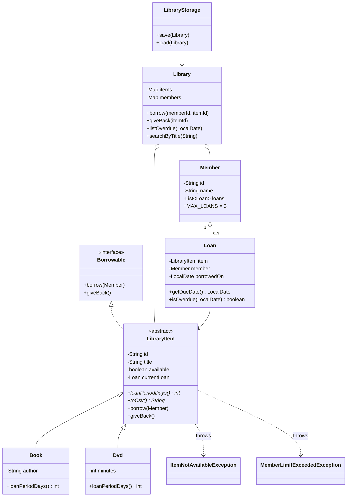

# Lab 11: Mini-Project - Library Management System

## How to run
```
javac *.java
java LibraryTest        # 19 automatic checks
java Main               # interactive menu; data saved in ./data
java Main mydata        # use a different data folder
```
Data is saved to `items.csv`, `members.csv` and `loans.csv` when you choose `0) Save and exit`
(or when input ends), and reloaded next time.

## Requirement checklist
- [x] `Book`, `Member`, `Loan` classes: private fields, validation, `toString`
- [x] `abstract LibraryItem` (id, title) with `Book` and `Dvd`, each with its own `loanPeriodDays()` (14 and 7)
- [x] `Borrowable` interface with `borrow(Member)` and `giveBack()`
- [x] `ItemNotAvailableException` and `MemberLimitExceededException` (maximum 3 loans)
- [x] Items and members stored in `Map<String, ...>` keyed by id
- [x] CSV persistence on exit, reload on start
- [x] Menu: add item, register member, borrow, return, list overdue, search by title (streams)

## Class diagram


## Short report
**Design (inheritance, abstraction, interface)**
- `LibraryItem` is abstract: common state (id, title, availability, current loan) and borrow/return logic live once.
- `Book` and `Dvd` only add their own data and loan period.
- `Borrowable` describes the lending behaviour as a contract, separate from the class hierarchy.

**Polymorphism**
- `Loan.getDueDate()` calls `item.loanPeriodDays()`; the right period (14 or 7 days) is picked at runtime.
- `toCsv()` is abstract too, so saving needs no `instanceof` checks.
- The `Library` code works on `LibraryItem` and never needs to know the concrete type.

**Encapsulation**
- All fields are private. `Member.getLoans()` returns an unmodifiable view, so the 3-loan limit cannot be bypassed.
- `addLoan` / `removeLoan` / `restoreLoan` are package-private, only reachable through the domain classes.
- Constructors and setters validate input (blank ids, names, non-positive minutes).

**Exceptions**
- Two checked exceptions force callers to handle expected business failures.
- `borrow` creates the loan and adds it to the member BEFORE marking the item unavailable, so a limit failure leaves everything unchanged.
- Unknown ids throw `IllegalArgumentException`; the menu catches everything and keeps running.

**Collections and streams**
- `Map<String, LibraryItem>` and `Map<String, Member>` (LinkedHashMap, keeps insertion order) give fast lookup by id.
- `searchByTitle` and `listOverdue` use `stream().filter().sorted().toList()`.

**Persistence**
- Three CSV files; loans store the original borrow date, so overdue status survives a restart.
- Commas in text are replaced by spaces on input so lines cannot break.
- A bad line is skipped with a message instead of stopping the load.

**Testing**
- `LibraryTest` checks loan periods, borrow, unavailable item, member limit, return, overdue, search and a save/reload round trip (19 checks, all pass).
- A scripted menu session is recorded in `output.txt`.

**Known limitations**
- No fines, reservations or passwords.
- CSV format cannot hold commas inside titles (they are replaced).
- No deletion of items or members.
